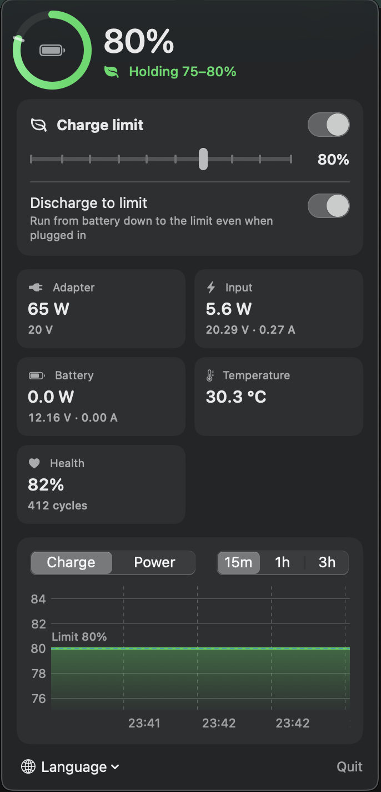

# macOS Charge Limiter

Limit the maximum battery charge on Apple Silicon MacBooks (for example to 80%) to slow down battery wear. Optionally discharge down to the limit while the adapter is still plugged in.

- A tiny root daemon run by `launchd` does the charge control. No kernel extensions.
- A native menu bar app shows live readings and charts and lets you change settings.
- Terminal commands do the same from the shell.

<p align="center">
  
</p>

## Why another one?

On older firmware Apple Silicon Macs exposed a native 80% limit through the `CHWA` SMC key ([this gist](https://gist.github.com/geokal/b0a9c53f94e8751f7a911834e3b85382) describes it). Since macOS 15 the key is gone. This project uses the keys that still exist:

| SMC key | Value | Effect |
|---|---|---|
| `CHTE` | `01000000` / `00000000` | pause / allow charging |
| `CHIE` | `08` / `00` | run from battery with adapter attached / normal |

The daemon checks the battery every 60 seconds, and right away when you change a setting. It pauses charging at the limit and resumes it 5% below.

## Requirements

- Apple Silicon Mac with macOS 13 or later (tested on M1 MacBook Air, macOS 26.2)
- [Homebrew](https://brew.sh) (used to get `smc` from smcFanControl)
- Rosetta 2 (the `smc` binary is x86_64): `softwareupdate --install-rosetta --agree-to-license`
- An admin account (install asks for your password)

## Install

```bash
bash -c "$(curl -fsSL https://raw.githubusercontent.com/XXanderWP/macos_charge_limiter/main/install.sh)"
```

The script downloads the latest version to a temporary folder, installs the daemon, commands and menu bar app, and cleans up. The app is taken from the [latest release](https://github.com/XXanderWP/macos_charge_limiter/releases/latest). If no release can be downloaded, it is built from source, which needs the Command Line Tools (`xcode-select --install`).

Pass options after `--`, for example `bash -c "$(curl …)" -- --limit 85`. Or install from a clone:

```bash
git clone https://github.com/XXanderWP/macos_charge_limiter.git
cd macos_charge_limiter
./install.sh
```

Options:

- `--limit N` sets the initial limit (50–95, default 80)
- `--build` builds the app from source instead of downloading the release
- `--no-app` installs only the daemon and terminal commands

The limit is enabled right after install and survives reboots. The app starts at login.

To update, run the install command again. Your settings are kept.

### About signing

The app isn't signed with an Apple Developer ID. Release builds are ad-hoc signed by GitHub Actions. Files downloaded with `curl` don't get the quarantine flag, so Gatekeeper doesn't block them. The installer also removes the flag, in case the zip came through a browser.

## Usage

### Menu bar app

Click the icon in the menu bar:

| Icon | Meaning |
|---|---|
| leaf | limit on |
| bolt | limit off |
| down arrow | discharging to the limit |

The panel shows:

- **Header**: charge ring with the limit mark, current state (holding, charging, discharging, on battery) and time to full or empty
- **Charge limit**: on/off switch, a 50–95% slider and the *Discharge to limit* switch
- **Live readings**, updated every second while the panel is open:
  - adapter profile, e.g. 65 W at 20 V
  - input voltage, current and power
  - battery voltage, current and power (positive while charging)
  - battery temperature
  - health (current vs. design capacity) and cycle count
- **Charts**: charge level with the limit line, or input and battery power, for the last 15 minutes, 1 hour or 3 hours. History is kept in memory since the app started.

The app is available in English, Russian and Ukrainian. By default it uses the first supported language from your system language list (System Settings → General → Language & Region) and falls back to English. Use the **Language** menu at the bottom of the panel to override it.

### Terminal

```bash
charge-limit-on            # enable the limit (last used value, 80% by default)
charge-limit-on 85         # enable and set the limit to 85%
charge-limit-off           # disable, charge to 100%
charge-limit-discharge on  # discharge to the limit even when plugged in
charge-limit-discharge off
charge-limit-status        # state plus adapter, battery and temperature readings
```

None of these need `sudo`.

## How it works

```
~/.charge-limit/
├── on          # present = limit enabled
├── max         # limit in percent (default 80)
├── discharge   # present = discharge down to the limit
└── lang        # optional language override (en, ru, uk)
```

| Path | What |
|---|---|
| `/usr/local/bin/smc` | SMC tool from smcFanControl |
| `/usr/local/bin/charge-limit-*` | daemon and commands |
| `/Library/LaunchDaemons/io.github.xxanderwp.charge-limiter.plist` | daemon launchd job (root) |
| `/Applications/ChargeLimiter.app` | menu bar app |
| `~/Library/LaunchAgents/io.github.xxanderwp.charge-limiter.app.plist` | starts the app at login |

The app and the commands only create or delete files in `~/.charge-limit`. The daemon watches this folder, runs as root and writes the SMC keys. The app reads battery data and the SMC state directly through IOKit, without root.

### Building the app

```bash
app/build.sh            # -> build/ChargeLimiter.app
```

Pushing a `v*` tag runs [.github/workflows/release.yml](.github/workflows/release.yml), which builds the app and publishes `ChargeLimiter.zip` as a release.

## Limitations

- **Sleep.** The daemon can't run while the Mac sleeps. If you plug in a sleeping Mac it may charge past the limit; charging stops again after it wakes. Likewise, discharging that started before sleep can continue below the limit until wake.
- **Lowering the limit** without *Discharge to limit* doesn't drain the battery: the Mac just runs from the adapter at the current level.
- **macOS Optimized Battery Charging** can interfere. Consider turning it off in System Settings → Battery → Battery Health.
- The SMC keys are undocumented and Apple may change them in a future firmware. The installer checks for `CHTE` and refuses to install if it's missing.

## Uninstall

```bash
./uninstall.sh                # add --keep-config to keep ~/.charge-limit
```

This removes the daemon, commands and app and restores normal charging. smcFanControl stays installed. Remove it with `brew uninstall --cask smcfancontrol`.

## Credits

- [geokal's gist](https://gist.github.com/geokal/b0a9c53f94e8751f7a911834e3b85382) for the original `CHWA` approach
- [actuallymentor/battery](https://github.com/actuallymentor/battery) for documenting `CHTE` / `CHIE`
- [smcFanControl](https://github.com/hholtmann/smcFanControl) for `smc`

## License

[MIT](LICENSE)
